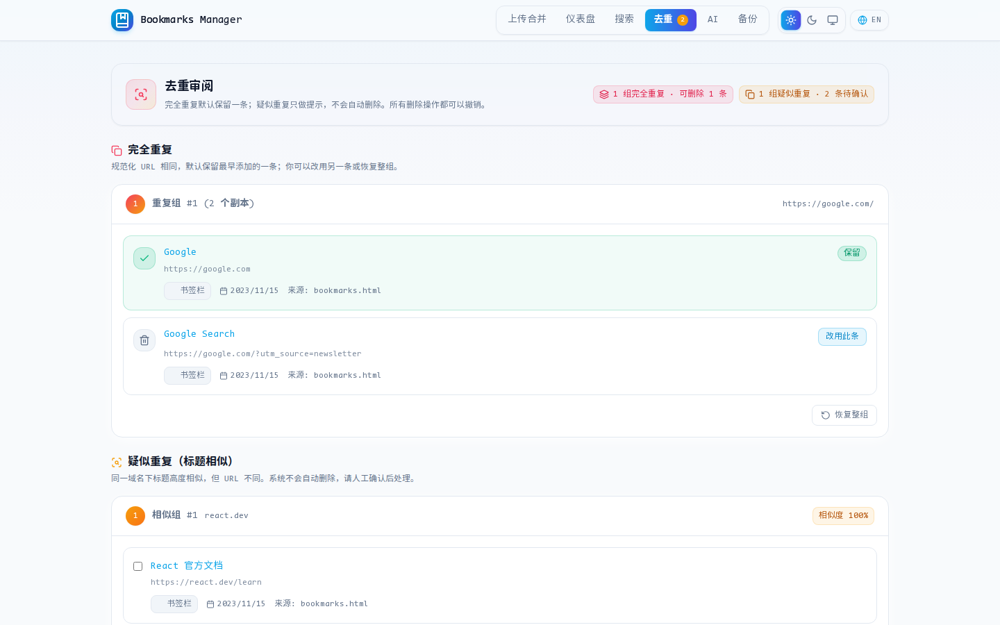

**English** | [中文](#chinese)

<a id="top"></a>

# Bookmarks Manager

A pure front-end, local-first cross-browser bookmark merging and smart cleanup tool. No registration, no backend service; data never leaves the browser.

[Use Online](https://holtwood-projects.github.io/bookmarks-manager/) · [GitHub Repository](https://github.com/holtwood-projects/bookmarks-manager) · [Report an Issue](https://github.com/holtwood-projects/bookmarks-manager/issues)

---

## UI Preview

|                    Landing page                    |                    Statistics dashboard                     |
| :------------------------------------------: | :-----------------------------------------------: |
|   |  |
|                 **Full-text search**                 |                   **Duplicate detection**                    |
|  |   |

---

## Core Features

- **Local-first**: pure front-end architecture; data is stored only in the browser's local IndexedDB, with zero uploads, safeguarding privacy.
- **Controllable deduplication**: normalizes URLs and collapses exact duplicates while keeping the earliest copy. Title-similar bookmarks are review candidates only, never auto-deleted. Switch the kept copy, restore a whole group, bulk-remove confirmed items, and undo any removal.
- **Full-text search**: local search over titles, links, and folder hierarchies with highlighting, multi-condition filters, per-item deletion, and export. Results are no longer truncated to 50.
- **Automatic categorization**: intelligently grouped by domain (AI, development, learning, news, tools, etc.), with multi-dimensional visual analytics.
- **Multiple format support**: compatible with standard Netscape HTML, supporting export to JSON, Markdown, CSV, and full-database snapshots.
- **PWA support**: can be installed as an app on the desktop to run standalone, with offline access.

---

## User Guide

### 1. Export Bookmarks

Export a standard HTML bookmarks file from your browser:

- **Chrome / Edge**: press `Ctrl + Shift + O` (macOS: `Cmd + Option + B`) to open the bookmark manager, click the menu in the top-right corner and choose **Export bookmarks**.
- **Firefox**: press `Ctrl + Shift + O` to open the Bookmarks Library, click **Import and Backup** → **Export Bookmarks to HTML...**.
- **Safari**: choose **File** → **Export Bookmarks...** from the top menu.

### 2. Import and Organize

1. Open [Bookmarks Manager](https://holtwood-projects.github.io/bookmarks-manager/), and drag in one or more bookmark HTML files (supports merging bookmarks from multiple browsers).
2. On the **Duplicates** page, review exact duplicates (switch or restore the kept copy) and confirm similar titles manually. Every removal can be undone from the top banner.
3. Search bookmarks on the **Search** page, or view domain and category statistics charts on the **Dashboard**.

### 3. Import Back into the Browser

1. Click **Export** in the top-right corner of the page and choose **HTML format** to download.
2. Return to your browser's bookmark manager and click **Import bookmarks**.
   > You can also export as JSON, Markdown, or CSV for knowledge-base archiving and backup.

---

## Local Development

```bash
git clone https://github.com/holtwood-projects/bookmarks-manager.git
cd bookmarks-manager
npm install
npm run dev
```

Build and checks:

```bash
npm run validate   # 类型检查、代码检查与单元测试
npm run build      # 生产构建
```

---

## License

[MIT](LICENSE)

---

<a id="chinese"></a>
[English](#top) | **中文**

# Bookmarks Manager

纯前端、本地优先的跨浏览器书签合并与智能清理工具。无需注册、无后端服务，数据不离开浏览器。

[在线使用](https://holtwood-projects.github.io/bookmarks-manager/) · [GitHub 仓库](https://github.com/holtwood-projects/bookmarks-manager) · [报告问题](https://github.com/holtwood-projects/bookmarks-manager/issues)

---

## 界面预览

|                    落地页                    |                    统计仪表盘                     |
| :------------------------------------------: | :-----------------------------------------------: |
|   |  |
|                 **全文搜索**                 |                   **重复检测**                    |
|  |   |

---

## 核心特性

- **本地优先**：纯前端架构，数据仅保存在浏览器本地 IndexedDB，零上传，保障隐私。
- **可控去重**：自动清洗追踪参数并规范化 URL，完全重复项合并并保留最早添加的版本；标题相似项仅作为待确认建议，不会自动删除。支持切换保留项、恢复整组、批量删除与撤销。
- **全文检索**：本地搜索标题、链接与目录层级并高亮关键词，支持多条件过滤、单条删除与结果导出；搜索结果不再截断为 50 条。
- **自动分类**：按域名智能归类（AI、开发、学习、资讯、工具等），提供多维度可视化分析。
- **多格式支持**：兼容标准 Netscape HTML，支持导出 JSON、Markdown、CSV 及整库快照。
- **PWA 支持**：可作为应用安装至桌面独立运行，支持离线访问。

---

## 使用指南

### 1. 导出书签

从浏览器导出标准 HTML 书签文件：

- **Chrome / Edge**：按 `Ctrl + Shift + O`（macOS: `Cmd + Option + B`）打开书签管理器，点击右上角菜单选择 **导出书签**。
- **Firefox**：按 `Ctrl + Shift + O` 打开书签库，点击 **导入和备份** → **导出书签到 HTML...**。
- **Safari**：顶部菜单选择 **文件** → **导出书签...**。

### 2. 导入与整理

1. 打开 [Bookmarks Manager](https://holtwood-projects.github.io/bookmarks-manager/)，拖入一个或多个书签 HTML 文件（支持多浏览器书签合并）。
2. 在 **去重** 页面审阅完全重复项（可切换或恢复保留项），人工确认疑似重复标题后再删除；所有删除都可在顶部横幅撤销。
3. 在 **搜索** 页面检索书签，或在 **仪表盘** 查看域名与分类统计图表。

### 3. 导回浏览器

1. 点击页面右上角 **导出**，选择 **HTML 格式** 下载。
2. 回到浏览器书签管理器，点击 **导入书签** 即可。
   > 亦支持导出为 JSON、Markdown 或 CSV 便于知识库归档与备份。

---

## 本地开发

```bash
git clone https://github.com/holtwood-projects/bookmarks-manager.git
cd bookmarks-manager
npm install
npm run dev
```

构建与检查：

```bash
npm run validate   # 类型检查、代码检查与单元测试
npm run build      # 生产构建
```

---

## 开源协议

[MIT](LICENSE)
